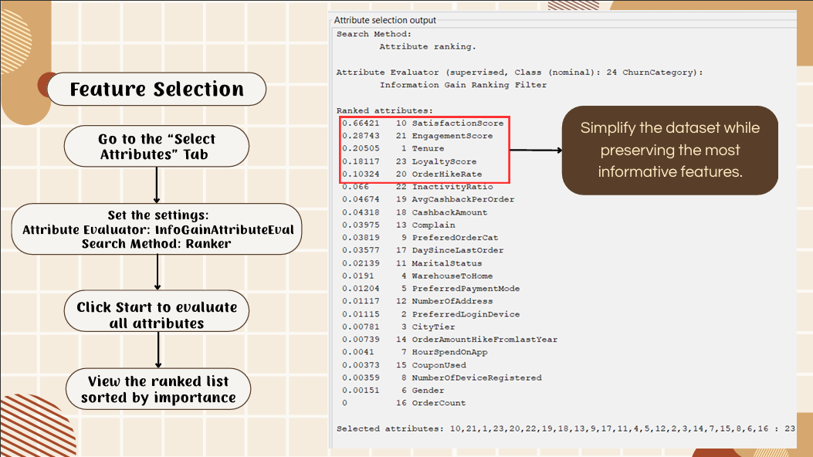
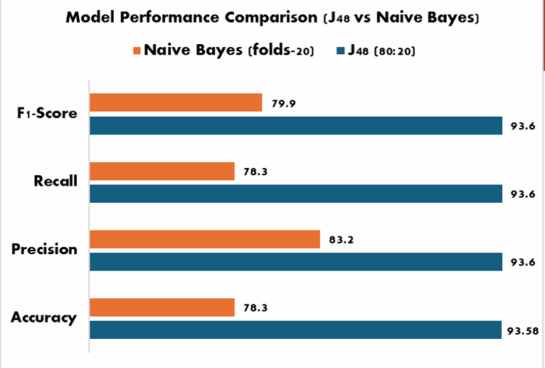
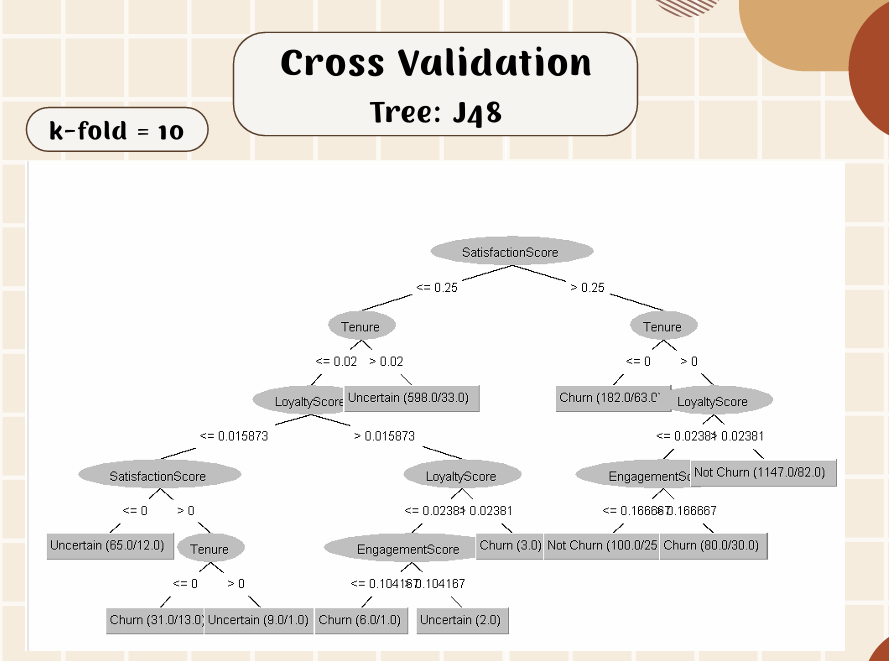

# 🛒 E-Commerce Customer Churn Analysis and Prediction

A data mining project focused on analyzing customer behavior and developing classification models to predict customer churn in an e-commerce environment.

This project was developed as an **Academic Group Project** for **ISP565 – Data Mining**.

## 📌 Project Overview

Customer churn can affect customer retention and long-term business performance. This project applies data mining techniques to an e-commerce customer dataset to identify patterns associated with churn and develop predictive classification models.

The project covers the complete data mining workflow, including:

- Data cleaning and preprocessing
- Missing value handling
- Outlier detection and removal
- Data normalization
- Feature engineering
- Feature selection
- Data reduction
- Classification modelling
- Model evaluation and comparison

## 📊 Dataset

The dataset was obtained from **Kaggle** and contains customer demographic, behavioral, transactional, and satisfaction-related attributes.

- **Original Instances:** 5,630
- **Attributes:** 25
- **Data Types:** Numeric and nominal
- **Target:** Customer churn category

The churn target was represented using three categories:

- Not Churn
- Uncertain
- Churn

## 🧹 Data Preprocessing

Data preprocessing was performed primarily using **WEKA**.

### Missing Values

Missing values were handled using WEKA's `ReplaceMissingValues` filter.

For numeric attributes, missing values were replaced using the attribute mean, while nominal attributes were handled using the most frequent value.

### Outlier Detection

Outliers were identified using the **Interquartile Range (IQR)** method.

After identifying outliers and extreme values, selected instances were removed using WEKA's `RemoveWithValues` filter.

The dataset was reduced from:

`5,630 → 4,447 instances`

### Normalization

**Min-Max Normalization** was applied to selected numeric attributes to transform their values into the range:

`0 – 1`

### Feature Engineering

Additional attributes were constructed during preprocessing, including:

`TotalSpendTime = HourSpendOnApp + EngagementScore`

## 🔍 Feature Selection

Feature importance was evaluated using:

- **Attribute Evaluator:** `InfoGainAttributeEval`
- **Search Method:** `Ranker`

The top-ranked attributes included:

1. SatisfactionScore
2. EngagementScore
3. Tenure
4. LoyaltyScore
5. OrderHikeRate

These features were used to create a reduced dataset for further model evaluation.



## 🤖 Classification Models

Two classification algorithms were evaluated:

### J48 Decision Tree

A decision-tree classifier used to generate interpretable decision rules for customer churn prediction.

### Naive Bayes

A probabilistic classification algorithm used as an alternative model for comparison.

Different evaluation strategies were tested, including:

- 10-Fold Cross-Validation
- 20-Fold Cross-Validation
- 70/30 Percentage Split
- 80/20 Percentage Split

## 📈 Model Evaluation

Model performance was evaluated using:

- Accuracy
- Precision
- Recall
- F1-Score
- ROC Area
- Confusion Matrix

The **J48 Decision Tree** achieved approximately **93.6% accuracy** on the full dataset using the reported 80/20 percentage split, with weighted precision, recall, and F1-score of approximately **0.936**.



## 🌳 Decision Tree Visualization

WEKA was also used to visualize the J48 decision tree and interpret the relationships between selected customer attributes and churn categories.



## 🛠️ Tools & Technologies

- WEKA
- Microsoft Excel
- Data Mining
- Data Preprocessing
- Feature Engineering
- Feature Selection
- J48 Decision Tree
- Naive Bayes
- Classification
- Model Evaluation

## 📁 Project Structure

```text
E-COMMERCE CUSTOMER CHURN/
├── data/
│   └── E Commerce Dataset.xlsx
├── screenshots/
│   ├── model_performance_comparison.png
│   ├── feature_selection.png
│   └── j48_decision_tree.png
├── report/
│   ├── ISP565_REPORT.pdf
│   └── ISP565 PROJECT PRESENTATION (UPDATED).pdf
└── README.md
```

## 🎯 Project Objectives

The main objectives of this project were to:

- Understand customer behavior and identify patterns related to churn.
- Develop classification models capable of predicting customer churn.
- Evaluate classification performance using accuracy, precision, recall, and F1-score.

## 👥 Project Type

**Academic Group Project**  
ISP565 – Data Mining

## 📝 Key Learning Outcomes

Through this project, we gained practical experience in:

- Preparing real-world datasets for data mining
- Handling missing values and outliers
- Performing feature engineering and feature selection
- Building classification models using WEKA
- Applying cross-validation and train-test splits
- Comparing machine learning classifiers
- Interpreting decision trees and classification metrics

## ⚠️ Note

This project was developed for academic and educational purposes. Model performance reflects the dataset and experimental setup used in this project and should not be interpreted as production-level churn prediction performance.